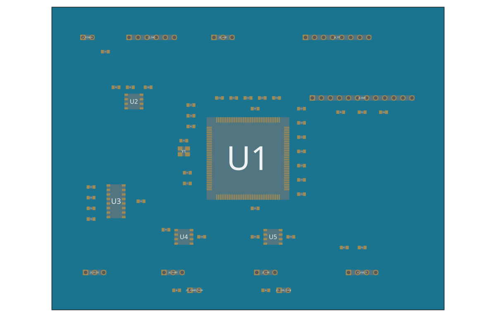

# STM32F746ZG communication board

This tscircuit project defines a schematic and preliminary placement on a 110 × 85 mm board. It uses an STM32F746ZGT6 in LQFP144 and an external regulated 3.3 V supply. The connector pin orders are defined in [board.tsx](board.tsx), starting at pin 1. TX and RX names are from the board's perspective.

Install Node.js 24 and Bun before running the tscircuit CLI.

```powershell
npm install
npm run dev
npm run build
```

Open the local URL printed by the preview command. The build command generates Circuit JSON.

The [editable KiCad schematic](output/industrial-comm-board.kicad_sch) embeds its symbols. The [A2 schematic PDF](output/pdf/industrial-comm-board.pdf) uses the same pin and net data from tscircuit.

| Interface  | STM32 signals                                                                                                     | Hardware                                                                                                                                       |
| ---------- | ----------------------------------------------------------------------------------------------------------------- | ---------------------------------------------------------------------------------------------------------------------------------------------- |
| UART       | UART4 AF8, PC10 TX / PC11 RX                                                                                      | J3, 3.3 V logic                                                                                                                                |
| I²C EEPROM | I2C1 AF4, PB6 SCL / PB7 SDA                                                                                       | U2 24LC256, 7-bit address 0x50, 4.7 kΩ pull-ups                                                                                                |
| SPI TFT    | SPI1 AF5, PA5 SCK / PA6 MISO / PB5 MOSI                                                                           | J4 for a 3.3 V SPI TFT module with onboard backlight drive. PA4 CS, PB0 D/C, PB1 reset                                                         |
| RS-232     | USART3 AF7, PD8 TX / PD9 RX                                                                                       | MAX3232 and J5, two-wire data plus ground                                                                                                      |
| RS-485     | USART6 AF8, PC6 TX / PC7 RX                                                                                       | THVD1450 and J6, half duplex. PC8 high enables the driver. JP1 enables 120 Ω termination                                                       |
| CAN        | CAN1 AF9, PB8 RX / PB9 TX                                                                                         | SN65HVD230 and J7, classical CAN. JP2 enables 120 Ω termination                                                                                |
| Ethernet   | RMII AF11, PA1 REFCLK / PA2 MDIO / PC1 MDC / PA7 CRS_DV / PC4 RXD0 / PC5 RXD1 / PG11 TXEN / PG13 TXD0 / PG14 TXD1 | J8 for a LAN8720A-based PHY daughterboard with magnetics and RJ45. The daughterboard supplies a 50 MHz REFCLK. PC0 drives active-low PHY reset |
| USB        | OTG_FS AF10, PA11 D− / PA12 D+                                                                                    | J9 for a USB receptacle daughterboard. PA9 senses VBUS through a divider. Device mode, self-powered                                            |

J1 takes regulated 3.3 V. Size the supply for the MCU and attached modules. J2 provides SWD and reset. Configure the MCU for an 8 MHz HSE bypass clock, derive an accurate 48 MHz USB clock, and use the PHY address strapped on the daughterboard. Leave each termination jumper open unless this board is at the relevant bus end. The RMII header uses a board-specific order. Match signals when selecting or wiring the daughterboard.

Routing is disabled in this revision. Before fabrication, select the exact daughterboards and mating connectors, verify footprints and power sequencing, add field-port surge and ESD protection and any required isolation, and complete routing and electrical and design-rule checks. Route USB as a 90 Ω differential pair and keep RMII connections short over a continuous reference plane. The RS-232, RS-485, and CAN ports share the board ground.

References

- [ST STM32F745xx/STM32F746xx datasheet, LQFP144 pinout and alternate functions](https://www.st.com/resource/en/datasheet/stm32f745zg.pdf)
- [Microchip LAN8720A datasheet, RMII and reference clock options](https://ww1.microchip.com/downloads/aemDocuments/documents/UNG/ProductDocuments/DataSheets/LAN8720A-LAN8720Ai-Data-Sheet-DS00002165.pdf)
- [tscircuit CLI quickstart](https://docs.tscircuit.com/intro/quickstart-cli)

## Pinout


